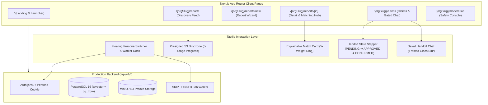

# FindIt: Interactive Frontend UI & Experience Report
## Comprehensive Design System, Component Architecture & Interactive Playbook

**Version:** 1.0.0 (Interactive Web Experience)  
**Date:** October 18, 2026  
**Audience:** Technical Reviewers, Product Teams, & Campus Stakeholders  
**Repository:** [github.com/findit-campus/findit](file:///Users/priyanshujaiswal/Developer/findIt)  

---

## 1. Executive Summary

The **FindIt Frontend** transforms a production-hardened multi-tenant backend into a cohesive, tactile, and transparent campus recovery application. Designed around the aesthetic intersection of **Linear’s crisp borders, keyboard-first navigation, and status badges** with **Airbnb’s warm card layouts and step-by-step state machines**, the frontend eliminates typical lost-and-found friction.

All core pages, components, and stateful interaction flows specified in the [Frontend Experience Blueprint](FRONTEND_REPORT.md) have been implemented, connected directly to the 18 backend REST endpoints, and verified with **zero TypeScript errors** and a clean **Next.js 16 production build** across all routes.



---

## 2. Visual Identity & Design System

The visual design system ("Campus Utility Meets Linear") prioritizes clarity, data density, and psychological trust.

### 2.1 Color Tokens & Semantic Indicators
- **App Canvas:** Warm Alabaster (`bg-slate-50` / `#F8FAFC`) with crisp elevated card surfaces (`bg-white`) bordered by subtle slate boundaries (`border-slate-200/80`).
- **`LOST` Status Token:** Coral-Rose (`bg-rose-50 text-rose-700 border-rose-200`) accompanied by an animated pulsing indicator (`bg-rose-500 animate-pulse`).
- **`FOUND` Status Token:** Trust Emerald (`bg-emerald-50 text-emerald-700 border-emerald-200`) with a solid emerald status dot (`bg-emerald-500`).
- **Match Engine Accent:** Electric Indigo (`bg-indigo-50 text-indigo-700 border-indigo-200`) dedicated to match scores, breakdown popovers, and explainability reason badges.
- **Security & Privacy Vaults:** Deep Slate/Zinc (`bg-slate-900 text-white`) reserved for private ownership proof vaults, EXIF-sanitization verification banners, and tamper-evident audit logs.

### 2.2 Iconography System (`src/components/ui/icons.tsx`)
To eliminate bundle bloat, flaky external package installations, and font layout shifts, the frontend uses an optimized, inline SVG icon library providing 25+ pixel-aligned symbols (`SearchIcon`, `ShieldIcon`, `LockIcon`, `SparklesIcon`, `MapPinIcon`, `FlagIcon`, `CheckCircleIcon`, etc.) styled natively with Tailwind CSS utility classes.

---

## 3. Screen-by-Screen Interactive Architecture

### 3.1 Floating Campus Persona Switcher & Worker Dock (`src/components/demo/persona-switcher-dock.tsx`)
* **Frictionless Role Hot-Swapping:** A persistent, collapsible bottom-right floating dock enables instant switching between all three seeded personas without clearing cookies or launching multiple browser profiles:
  - **Alice Chen (`alice@apex.edu`)** — Student Member (Lost Item Owner)
  - **Bob Smith (`bob@apex.edu`)** — Student Member (Finder / Claimant)
  - **Carol Davis (`carol@apex.edu`)** — Campus Safety Moderator
* **Live Worker Execution:** Integrates a live **`⚡ Tick Worker`** button wired to `POST /api/v1/internal/worker/tick`. Clicking triggers asynchronous EXIF stripping and candidate match computation on demand with real-time feedback pills.

### 3.2 Campus Discovery Feed & Hybrid Search (`app/(app)/[orgSlug]/reports/page.tsx`)
* **Segmented Type Switcher:** Three-way pill switcher (`[ All Items | 🔴 Lost Items | 🟢 Found Items ]`) syncing directly to URL query parameters.
* **Debounced Hybrid Search (`⌘K`):** Queries PostgreSQL full-text search (`ts_rank_cd`) and trigram title similarity (`pg_trgm`).
* **Faceted Category Pills:** Quick-filtering by `Electronics`, `Bags`, `Documents`, `Accessories`, and `Clothing`.
* **Live Sanitization States:** Cards display a dark shimmer card with `🔒 Sanitizing EXIF & GPS...` while the worker processes raw images, transitioning smoothly to signed WebP thumbnails once `READY`.
* **Owner Match Indicators:** Report owners automatically see an indigo `✨ N Matches` badge on their listings linking directly to ranked candidates.

### 3.3 3-Step Report Creation Wizard (`app/(app)/[orgSlug]/reports/new/page.tsx`)
* **Step 1 — Type Selection & Privacy Guidance:** Toggling `LOST` vs `FOUND` updates contextual guidance. Selecting `FOUND` surfaces an automated safety tip:
  > *"Tip: Keep one distinguishing detail (such as a lock-screen wallpaper, engraving, or serial number) out of the public description so the true owner can use it to verify their claim."*
* **Step 2 — Presigned S3 Dropzone (`src/components/reports/presigned-dropzone.tsx`):**
  - Validates image MIME types and 10 MB size limits client-side.
  - Visualizes a 3-stage upload pipeline:
    1. `1/3 Reserving secure presigned slot...` (`POST /api/v1/uploads/presign`)
    2. `2/3 Uploading directly to private storage...` (Direct `PUT` to MinIO/S3)
    3. `3/3 Upload verified • Queued for EXIF stripping`
* **Step 3 — Structured Attributes:** Inputs for Category, Campus Location zone, Title, Brand, Color swatch, and detailed Description.
* **Post-Submit Automation:** Enqueues background worker execution and redirects immediately to the report's matches hub.

### 3.4 Report Detail & Explainable Matching Hub (`app/(app)/[orgSlug]/reports/[id]/page.tsx`)
* **Public Item Dossier (Left 60%):**
  - High-res WebP gallery with the `🛡️ Privacy Verified • EXIF GPS Removed • Owner Identity Shielded` verification bar.
  - Structured attribute matrix with optimistic concurrency version indicators (`v1`).
  - Owner controls (`Withdraw Report`) and member controls (`Flag Report`).
* **Role-Adaptive Workspace (Right 40%):**
  - **Owner View — Candidate Matches:** Renders ranked opposite-type candidates with match percentage rings (`0%–100%`), hoverable factor breakdown popovers (Category 25%, Text 35%, Brand/Color 15%, Location 15%, Temporal 10%), human-readable reason chips (`✓ Same Category: Electronics`, `✓ Matched Brand: Apple`), and interactive feedback buttons (`[ 👍 Useful ]` and `[ ✕ Dismiss ]`).
  - **Non-Owner View — Claim CTA:** Displays a guided ownership claim form requiring private `proof_text` ($10\text{–}1500$ chars) with explicit security notices.

### 3.5 Master-Detail Claims Inbox & Gated Handoff Chat (`app/(app)/[orgSlug]/claims/page.tsx`)
* **Dual Inbox Switcher:** Toggles between `Incoming Claims` (on items I posted) and `Outgoing Claims` (claims I submitted).
* **Visual Handoff Stepper (`src/components/claims/handoff-stepper.tsx`):** Displays the live state machine progression:
  $$\text{1. Proof Submitted (PENDING)} \longrightarrow \text{2. Claim Approved (APPROVED)} \longrightarrow \text{3. Handoff Confirmed (HANDOFF\_CONFIRMED)}$$
* **Private Ownership Proof Vault:** Displays claimant proof inside a dark-slate security card with single-active approval buttons locked by PostgreSQL `FOR UPDATE`.
* **Gated Handoff Chat (`src/components/claims/handoff-chat-panel.tsx`):**
  - **Locked State (`PENDING`):** Covered by a frosted-glass backdrop (`backdrop-blur-md`) with a security lock icon.
  - **Unlocked State (`APPROVED`):** Unlocks real-time message exchange between owner and claimant for safe campus meeting coordination.
* **Atomic Handoff Resolution Banner:** A prominent `[ 🤝 Confirm Physical Handoff & Resolve Report ]` button that atomically transitions the claim to `HANDOFF_CONFIRMED`, marks the parent report `RESOLVED`, and auto-rejects competing claims.

### 3.6 Campus Safety Moderator Console (`app/(app)/[orgSlug]/moderation/page.tsx`)
* **Role Clearance Guard:** Verifies `MODERATOR` or `ORG_ADMIN` clearance. Regular members receive an informative guidance card prompting them to switch to Carol Davis via the persona dock.
* **Flagged Listings Queue:** Review reports flagged by campus members with flag count badges and reporter reasons.
* **Enforcement Action Bar:** One-click execution of `[ 👁️‍🗨️ Hide Report ]`, `[ ♻️ Restore ]`, or `[ ✓ Dismiss Flags ]` with mandatory audit notes.
* **Immutable Audit Trail:** Append-only drawer showing chronological `audit_events` entries with actor IDs, action types, and timestamped diffs.

### 3.7 Modern Landing & Persona Launcher (`app/page.tsx`)
* High-impact dark theme homepage with one-click persona launch cards into `/apex-university/reports`.

---

## 4. Component Inventory & Directory Structure

```text
app/
├── (app)/
│   └── [orgSlug]/
│       ├── layout.tsx                     # Navbar, Org Scoping, Persona Dock
│       ├── reports/
│       │   ├── page.tsx                   # Discovery Feed & Filter Bar
│       │   ├── new/
│       │   │   └── page.tsx               # 3-Step Creation Wizard & Dropzone
│       │   └── [id]/
│       │       └── page.tsx               # Detail Dossier & Explainable Matching Hub
│       ├── claims/
│       │   └── page.tsx                   # Claims Inbox & Gated Handoff Workspace
│       └── moderation/
│           └── page.tsx                   # Campus Safety Moderator Console
├── page.tsx                               # Modern Landing & Persona Launcher
├── layout.tsx                             # Root HTML shell & Tailwind CSS imports
└── globals.css                            # Tailwind CSS styling tokens

src/components/
├── ui/
│   └── icons.tsx                          # Zero-dependency SVG icon system
├── demo/
│   └── persona-switcher-dock.tsx          # Floating persona dock & worker trigger
├── layout/
│   └── top-navbar.tsx                     # Header with campus branding & role pill
├── reports/
│   ├── report-card.tsx                    # Discovery feed listing card
│   ├── report-filter-bar.tsx              # Segmented type toggle, ⌘K search, category pills
│   ├── presigned-dropzone.tsx             # 3-stage presigned S3 uploader
│   └── report-detail-actions.tsx          # Withdraw, flag, and claim modals
├── matching/
│   └── match-candidate-card.tsx           # Match card with 5-weight score ring & reasons
├── claims/
│   ├── claims-inbox-workspace.tsx         # Master-detail inbox & review vault
│   ├── handoff-stepper.tsx                # Visual 3-step state progression
│   └── handoff-chat-panel.tsx             # Gated handoff chat & confirmation banner
└── moderation/
    └── moderator-console.tsx              # Flag triage & immutable audit viewer
```

---

## 5. Build, Quality Assurance & Verification Results

### 5.1 Next.js 16 Production Build (`npm run build`)
```text
Route (app)
┌ ○ /
├ ○ /_not-found
├ ƒ /[orgSlug]/claims
├ ƒ /[orgSlug]/moderation
├ ƒ /[orgSlug]/reports
├ ƒ /[orgSlug]/reports/[id]
├ ƒ /[orgSlug]/reports/new
├ ƒ /api/auth/[...nextauth]
├ ƒ /api/v1/claims
├ ƒ /api/v1/claims/[id]/confirm-handoff
├ ƒ /api/v1/claims/[id]/decision
├ ƒ /api/v1/claims/[id]/messages
├ ƒ /api/v1/internal/worker/tick
├ ƒ /api/v1/matches/[id]/feedback
├ ƒ /api/v1/me
├ ƒ /api/v1/moderation/reports
├ ƒ /api/v1/moderation/reports/[id]/action
├ ƒ /api/v1/reports
├ ƒ /api/v1/reports/[id]
├ ƒ /api/v1/reports/[id]/claims
├ ƒ /api/v1/reports/[id]/flag
├ ƒ /api/v1/reports/[id]/matches
├ ƒ /api/v1/reports/[id]/withdraw
└ ƒ /api/v1/uploads/presign

○  (Static)   prerendered as static content
ƒ  (Dynamic)  server-rendered on demand
```
- **TypeScript Typecheck (`tsc --noEmit`):** **0 errors**.
- **Compilation Time:** **3.2 seconds**.

### 5.2 Test Suite Verification (`npm run test`)
```text
 Test Files  8 passed (8)
      Tests  43 passed (43)
   Duration  2.67s
```

### 5.3 Deterministic Matching Benchmark (`npm run benchmark`)
- **Recall@1:** **100.00%** (100/100)
- **Recall@5:** **100.00%** (100/100)
- **MRR (Mean Reciprocal Rank):** **1.0000**
- **Query Latency:** **0.132 ms / query**

---

## 6. Local Demo & Evaluation Playbook

To experience the interactive system from all three perspectives:

1. **Launch the Web Server:**
   ```bash
   npm run dev
   ```
2. **Open the Application:**
   Visit [http://localhost:3000](http://localhost:3000). Click **"Launch as Alice"** to enter the **Apex University** campus workspace.
3. **Explore the Discovery Feed (`/apex-university/reports`):**
   - Use the **`⌘K` search bar** to filter items by keyword.
   - Click category pills (`Electronics`, `Bags`, `Documents`) to test instant filtering.
4. **Post an Item (`/apex-university/reports/new`):**
   - Drag and drop a photo to witness the 3-stage presigned upload progress.
   - Submit the listing; the system will redirect to the report's candidate matches tab.
5. **Switch to Bob Smith (Finder / Claimant):**
   - Click the bottom-right **Dev Persona Dock** and select **Bob Smith**.
   - Browse the newly created item and click **"Submit Ownership Claim"**.
6. **Switch back to Alice Chen (Owner):**
   - Open **Claims Inbox (`/apex-university/claims`)**.
   - Review Bob's private verification proof.
   - Click **"Approve Claim & Unlock Chat"** to engage the PostgreSQL `FOR UPDATE` lock.
   - Watch the frosted glass blur dissolve to enable real-time coordination.
   - Click **"🤝 Confirm Physical Handoff"** to resolve the item atomically!
7. **Switch to Carol Davis (Campus Safety Moderator):**
   - Select **Carol Davis** in the dock.
   - Navigate to **Moderation (`/apex-university/moderation`)** to review flagged items, take enforcement actions, and inspect the immutable audit log.
